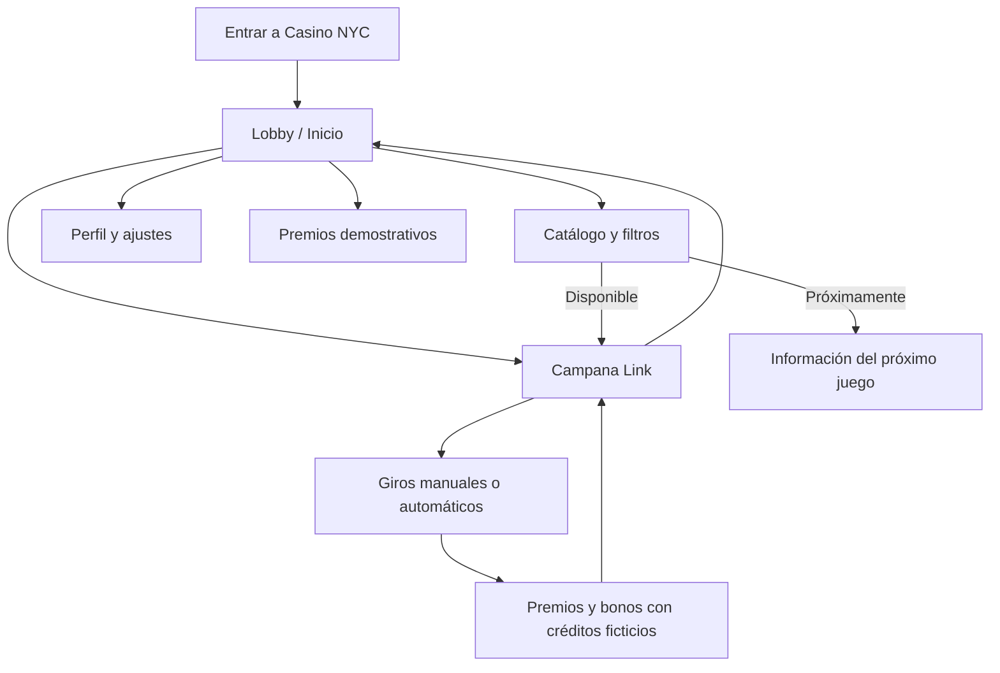

# Casino NYC — Estudio de producto, UX y arquitectura

**Fecha:** 12 de noviembre de 2026  
**Alcance:** casino **recreativo** para navegador, con puntos ficticios y sin ninguna operación de dinero real.  
**Estado:** lobby funcional MVP + Campana Link jugable; catálogo ampliable. Este documento distingue las funciones desarrolladas de la hoja de ruta.

## 1. Objetivo del producto

Construir una experiencia tipo sala de juegos optimizada para iPhone y Android, sin reducir la pantalla de una tragamonedas a un pequeño iframe. El lobby debe ser **el punto de entrada**, mostrar de forma inequívoca el contenido disponible y conservar preferencias sencillas en el navegador.

**Usuarios previstos:** visitantes recreativos que entran desde su teléfono y quieren localizar un juego, continuar una sesión de demostración o consultar créditos y reglas. No hay operadores, cajeros ni cuentas de dinero real.

## 2. Flujo principal



## 3. Matriz de funcionalidades

| Función | Estado del MVP | Comportamiento verificable |
| --- | --- | --- |
| Inicio / lobby | Implementado | Portada, banner, botón Jugar, saldo de prueba y continuación |
| Catálogo | Implementado | Cuatro fichas: una jugable y tres próximas |
| Búsqueda | Implementado | Filtrado instantáneo por nombre y tipo |
| Categorías | Implementado | Todos, Tragamonedas, Mesas, Favoritos |
| Favoritos | Implementado | Activar/desactivar y conservar en `localStorage` |
| Premios | Implementado | Valores ficticios no progresivos de Campana Link |
| Perfil | Implementado | Apodo local y ajustes de sonido |
| Créditos compartidos | Implementado | Saldo de muestra común entre lobby y Campana Link |
| Regalo demo | Implementado | 100 créditos ficticios, una vez por período de 24 h en el navegador |
| Reinicio | Implementado | Restablece saldo y contador de giros de demostración |
| Giro automático | Implementado | Series de 5, 10, 25 o 50 giros; botón de parada y control de saldo |
| Ruleta y otras tragamonedas | Pendiente | Tarjetas informativas, **no** juegos funcionales |
| Registro de usuarios / servidor | No incluido | MVP local, sin backend ni autenticación |
| Depósitos, retiros y pagos | Fuera de alcance | No se aceptan apuestas de dinero real |
| Publicación GitHub Pages | Requiere configuración del repositorio | Publicar desde rama `MAIN` y raíz |

## 4. Diseño y experiencia de usuario

- **Mobile-first** con barra inferior fija de cinco secciones y cabecera compacta.
- Los controles principales deben ser cómodos para uso táctil, con espacios seguros para los bordes y elementos del sistema operativo.
- Contraste visible: fondo negro/berenjena, acentos dorados para acciones, separación clara entre información y botones.
- Evitar recortes de textos o recuadros mediante `min-width: 0`, alturas mínimas en lugar de alturas rígidas, `overflow-wrap` y adaptaciones por ancho.
- El juego se abre como página propia (`games/campana-link.html`) y tiene acceso de vuelta al lobby. Esto da a los rodillos el mayor espacio disponible.
- Evitar clasificar como jugables productos aún no desarrollados.

En cuanto a accesibilidad, WCAG 2.2 establece un mínimo general de **24 × 24 píxeles CSS** para objetivos táctiles, sujeto a excepciones. En Casino NYC se utiliza normalmente un tamaño mayor, cercano a 44 píxeles o más, cuando el diseño lo permite. Fuente: https://www.w3.org/TR/WCAG22/#target-size-minimum

## 5. Arquitectura MVP

```text
/
├── index.html                  # Lobby
├── lobby.css                   # Apariencia y adaptación móvil
├── lobby.js                    # Navegación, búsqueda, favoritos, perfil, créditos
├── games/
│   └── campana-link.html       # Slot con gráficos y giros automáticos
├── icons/
│   └── casino-nyc.svg         # Icono visual
├── manifest.webmanifest        # Metadatos para añadir a inicio
├── README.md
└── ESTUDIO_CASINO_NYC.md
```

No se necesita compilación ni servidor de aplicaciones: GitHub Pages puede servir los archivos estáticos directamente. Hay que habilitar **Settings → Pages → Deploy from a branch → MAIN → /(root)**. Referencia: https://docs.github.com/en/pages/getting-started-with-github-pages/configuring-a-publishing-source-for-your-github-pages-site

El manifiesto facilita la presentación del sitio como aplicación web. Su instalación y comportamiento pueden variar según navegador; el MVP no promete un funcionamiento sin conexión ni equivale a una app nativa. Referencia: https://developer.mozilla.org/en-US/docs/Web/Progressive_web_apps/Guides/Making_PWAs_installable

### Persistencia local

| Clave | Datos almacenados |
| --- | --- |
| `campana_link_demo_v2` | Crédito de prueba, apuesta seleccionada, contador de giros |
| `casino_nyc_favorites` | IDs de juegos favoritos |
| `casino_nyc_profile` | Apodo y último juego abierto |
| `casino_nyc_settings` | Sonido encendido/apagado |
| `casino_nyc_last_daily` | Marca de tiempo de la última entrega ficticia |

**Advertencia:** el almacenamiento del navegador no es un sistema seguro de cuentas. Se borra al limpiar datos o al cambiar de dispositivo y puede manipularse localmente. No debe usarse para gestionar dinero, premios reales ni saldos confiables.

## 6. Reglas del giro automático

- El jugador elige 5, 10, 25 o 50 giros normales.
- Solo hay una serie de autogiros a la vez; durante el giro se bloquean las apuestas y el reinicio.
- El botón **Detener Auto** solicita que termine el giro en curso y luego detiene la serie.
- Si se agotan los créditos de demostración, el siguiente giro normal no empieza.
- Los giros de bonificación, cuando se activan, continúan según las reglas existentes y no restan del contador de giros normales elegido.
- No se realizan solicitudes bancarias ni pagos.

## 7. Pruebas efectuadas y pendientes

**Pruebas automatizadas con Chromium realizadas durante el desarrollo:** vistas de 320×568, 375×667, 393×852 y 1440×900 píxeles; sin desplazamiento horizontal en la portada; cambio de secciones; búsqueda; favoritos; apodo; sonido; modal de juego aún no disponible; carga de Campana Link y presencia del botón Auto Jugar; giro automático y solicitud de detener tras un giro, sin errores de JavaScript observados.

**Pendiente antes de llamar al producto terminado:** prueba manual en Safari real (iPhone), continuidad de saldos entre páginas en el dominio publicado, auditabilidad matemática y estadística del juego, accesibilidad con VoiceOver, redes lentas, fallos de almacenamiento local, pulido adicional de gráficos y rendimiento en móviles de gama baja.

## 8. Riesgos y límites

- **Juego de azar:** no se ha realizado una certificación de aleatoriedad, RTP ni pagos. Los valores mostrados son ficticios.
- **Propiedad intelectual:** los símbolos y estilo se inspiran en una máquina de referencia. Antes de uso comercial deberían revisarse marcas, imágenes y licencias.
- **Privacidad:** no introducir contraseñas ni datos personales en este prototipo; cualquier futuro backend requerirá autenticación y protección de datos.
- **Si en el futuro se quieren apuestas con dinero real:** antes de desarrollar esa posibilidad se necesita asesoramiento legal, licencias aplicables, controles de edad, geolocalización, autoexclusión y juego responsable, procesos de pagos autorizados, auditorías y seguridad del servidor. El MVP no está diseñado ni autorizado para ese uso.

## 9. Plan de evolución

**Fase 2 — Biblioteca real de juegos:** añadir juegos terminados uno por uno, con cartas de catálogo enlazadas a rutas existentes y pruebas de cada juego.

**Fase 3 — Calidad de producto:** separar los recursos visuales pesados, probar 60 FPS en dispositivos objetivo, soporte completo de lector de pantalla, controles visuales de brillo y movimiento, y eventual modo offline.

**Fase 4 — Plataforma multiusuario recreativa:** si el proyecto lo requiere, agregar perfiles autenticados y backend para sincronizar progreso ficticio; las reglas de negocio no deberían depender de `localStorage`.

**Conclusión:** la primera entrega óptima es un lobby útil, rápido y honesto con una tragamonedas realmente jugable. El resto del catálogo debe crecer sin inventar funciones ni comprometer la experiencia móvil.
